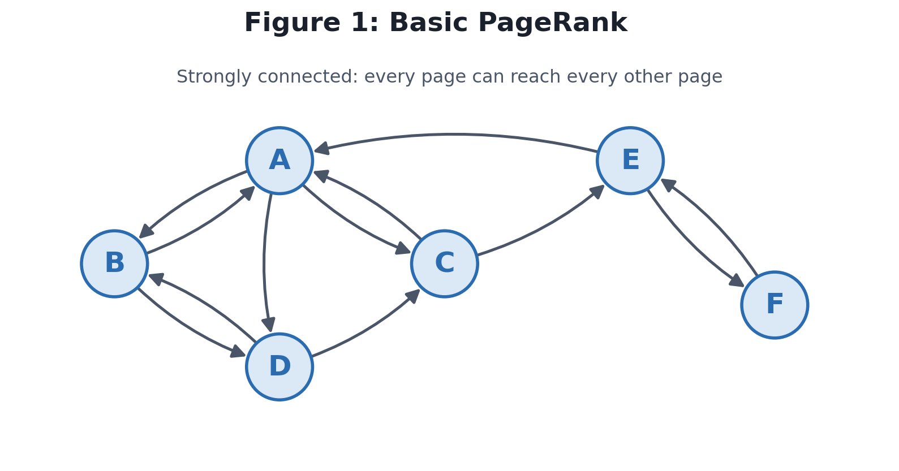
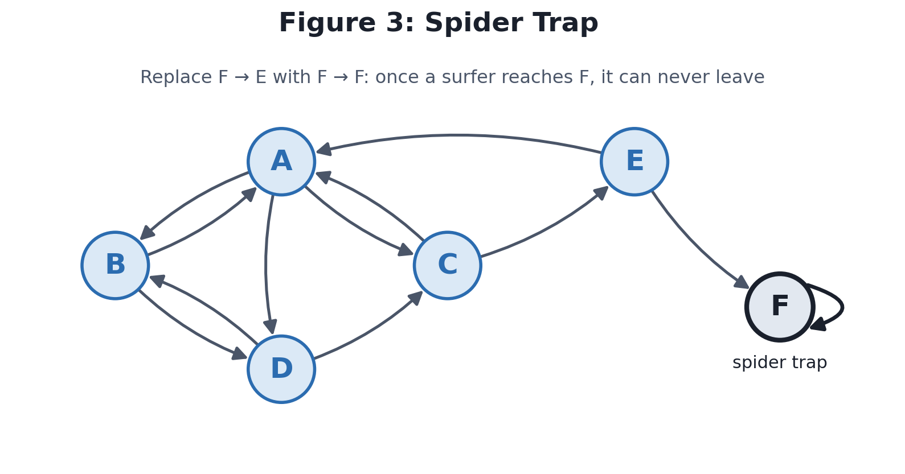
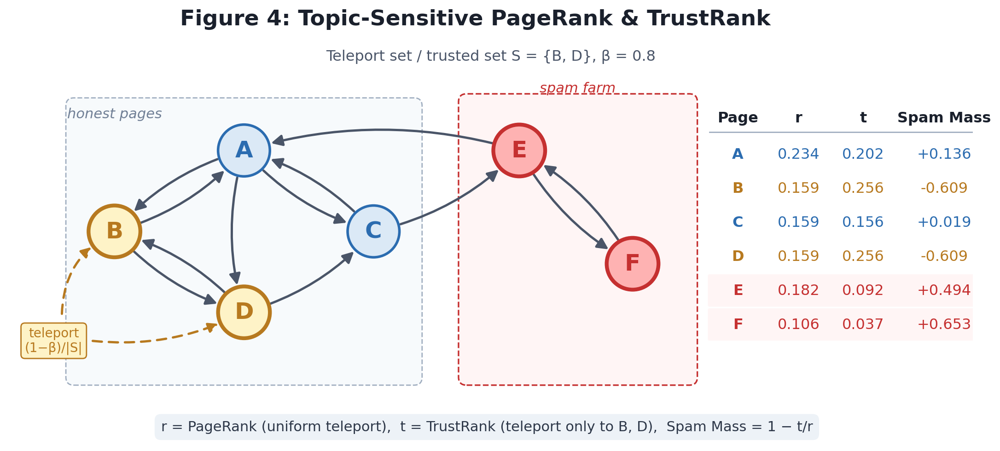

<head>
<title>PageRank</title>

</head>

# PageRank
__Outline__
1. Archaic search engines and Term Spam
2. Basic PageRank
3. Dead Ends and Spider Traps
4. Taxation

__Reading__ 
* Leskovec, Chapter 5
* [PageRank: Link Analysis Explanation and Python Implementation from Scratch, *Towards Data Science*](https://towardsdatascience.com/pagerank-3c568a7d2332)  

Early search engines
* Programs would crawl through websites, listing terms (words or other strings of characters other than white space) used in that page.
* The list of terms would be stored in an inverted index (a data structure that makes it easy, given a term, to find all places where that term occurs)
* A search query would move through the inverted index and look for pages with the searched terms
  * The result would be a ranked list of pages that use those terms

Problems
* __Term Spam__ refers to techniques for fooling search engines into believe your page is about something it is not
  * To attract users to their website, some developers would take a list of key terms and add it to their webpage multiple times in a font the same color as the background so they'd get a high ranking in these early search engines
  * Example, you have a website to sell GPS units, but want to attract anyone who is searching for local hikes
    * You encode the webpage with the words "local" and "hike" repeated multiple times
    * If your page is grey, then you change the font color of the repeated words to be the same shade of grey so they aren't immediately apparent to the user
    * The more times the words "local" and "hike" appear in your page, the more likely your website will get a high rank in a search query
    
Two men worked on a new piece of software named __PageRank__ which combats term spam:
* A search query creates __web surfers__, or random paths following pages link to link
  * Website A has a link to website B and follows it, and finds on site B a link to site C, and so on, crawling from link to link through the web
* Other components are also considered, such as how many sites link to that page
* Calculating the probability that a site is at the end of the crawl gives a way to rank the sites

We'll look at
1. Strongly connected websites (no dead ends)
2. Other components on the web that introduce dead ends
3. Spider Traps
4. Using taxation to resolve dead ends and spider traps

## Graph Analysis
Many datasets are naturally linked to each other. This network can be described as graphs:
- nodes (vertices) represent points of data
- edges (links) represent links between nodes, indicated as vectors between nodes

Graph analysis studies the structure of these connections rather than the attributes of each item on its own.

- __Directed vs. undirected__: On the web, a link from page A to page B does not imply a link from B to A, so the web is a directed graph. A friendship network is usually undirected.
- __Degree__: The out-degree of a node is the number of edges leaving it (links on a page). The in-degree is the number of edges entering it (pages linking to it).
- __Paths and connectivity__: A graph is __strongly connected__ if every node can reach every other node by following directed edges. Parts of the web that violate this (pages with no out-links, or groups of pages you can’t leave) cause problems for PageRank.
- __Matrix representation__: A graph with $n$ nodes can be stored as an $n \times n$ matrix whose entries describe the edges. This lets us use linear algebra (matrix–vector multiplication) to analyze the graph.
- __Importance from structure__: The key idea behind PageRank is that a node’s importance can be measured by who links to it. A link from an important page counts for more than a link from an obscure one.

Other common uses of graph analysis in data mining include social network analysis, community detection, recommendation systems, and fraud detection.

## PageRank
### Strongly connected websites

Create a transition matrix ($M$)
* Each column is a starting page (A, B, C, or D)
* Each row is a linked page that is linked to from a starting page
* The values are the probability that a linked page is selected from the given starting page
  * $1/k$ where there are $k$ links on a page
  * This process is __stochastic__
    * There is an equal probability (random chances) for each page to be selected
    * The total probability of each column is 1

Starting vector $\mathbf{v_0}$
* A vector of size $n$ (the number of sites in the graph) whose elements are $1/n$, indicating the probability of that being a starting page

A simulated web surfer's first step:
$$v_1 = Mv_0$$

The result of this multiplication is the probability of landing on each site after the first step. Find the probability of each following step:
$$v_{i+1} = Mv_i$$

If we complete this a large number of times, the vector will approach the probability of ending up on that particular site. The sites with the highest probabilities are listed first in the search query. 

> [PageRank Code - Strongly Connected Websites](./Code/08_PageRank.ipynb)

### Dead ends

This process is no longer stochastic, since the total of column C is 0, not 1. Since some columns are stochastic, but not all, we call this __substochastic__.

> [PageRank Code - Dead Ends](./Code/08_PageRank.ipynb)

Two approaches to dealing with dead ends
1. Drop all dead ends
   * Will also need to drop sites that only lead to dead ends
   * If site J leads only to K, and K is a dead end, then K is dropped. J then become a dead end, so will also need to be dropped
2. Modify the process by which random surfers are assumed to move about the web (the modification we'll look at is "taxation")

### Spider traps
Occasionally, a website will link to itself (e.g. a website links to a section halfway down the page, another link returns the user to the top of the page). If the only links on a website are to itself, then it is called a __spider trap__. As there are links, it is not a dead end. Although this may make sense as a web developer, it does mess up the PageRank algorithm.

### Taxation
To resolve this, we use a process called __taxation__. We modify the PageRank algorithm by allowing each random surfer a small probability of *teleporting* to a random page. If there is a probability $\beta$ (taxation parameter) that a surfer is not teleported, then our random surf equation becomes,
$$\mathbf{v}' = \beta M\mathbf{v} + \frac{1-\beta}{n}\mathbf{e}$$

where $\mathbf{e}$ is a vector of 1's the same size as $\mathbf{v}$ and where $n$ is the size of the vector $\mathbf{v}$ (or the number of webpages in question). The term on the right increases the probabilty of randomly ending up on another page (e.g. the user stops a current line of search and goes somewhere else). Generally, the probability of not being transported is set between $\beta=70$ and $\beta=90$.

> [PageRank Code - Taxation](./Code/08_PageRank.ipynb)

We have looked at how PageRank is used based on links to other pages. Every search engine has a more complicated algorithm based on more components:
* Number of pages with links to that page
* Frequency of words used
* Relevance of word usage based on words around it (Natural Language Processing)
* ...etc...

Google is said to have over 250 different components to their algorithm. Normally, the weighting of properties is such that unless all the search terms are present, a page has very little chance of being high on the list.

## 5.2 Efficient Computation of PageRank
The real web is far more complicated than the example we just did. There are, however, two major problems,
1. With billions of websites ($n$), the matrix will be $n\times n$, with over $10^{18}$ elements. It would be a very sparse matrix since no website links to more than a handful of websites.
2. We could use MapReduce to do the calculation, but the basic approaches are not sufficient to avoid heavy use.

### Representing the matrix
A matrix representing $n$ websites will take $n^2$ bytes. However, if we use locality-sensitive hashing, then we don't need to store the entire (sparse) matrix. In fact, the space needed for the relevant information in the matrix will no longer be quadratic, but a linear relationship to the number of links involved.

In addition, every value for a link within a page will have the same value: 1 divided by the out-degree of the page (the number of links on the page). Using the links from Figure 5.1,

$$M=\begin{bmatrix}
  0 & 1/2 & 1 & 0 \\
  1/3 & 0 & 0 & 1/2 \\
  1/3 & 0 & 0 & 1/2 \\
  1/3 & 1/2 & 0 & 0 \end{bmatrix}$$

The matrix $M$ has 16 elements, so it would take 16 bytes of memory. But if we use LSH, 

| Source | Degree | Value | Destinations |
| ------ | ------ | ----- | ------------ |
| A      | 3      | 1/3   | B,C,D        |
| B      | 2      | 1/2   | A,D          |
| C      | 1      | 1     | A            |
| D      | 2      | 1/2   | B,C          |

The LSH list would be:
* (B, 1/3)
* (C, 1/3)
* (D, 1/3)
* (A, 1/2)
* (B, 1/2)
* (A, 1)
* (B, 1/2)
* (C, 1/2)

That is 8 entries. If each takes 4 bytes, then that is 32 bytes of memory. For this example, the LSH takes up more space. However, if we add two more sites, $M$ increases to 36 bytes, and LSH only increases by the number of links on the two pages (if there are 2 links on each page, it goes up to 36 bytes).

If we have a network of 500 websites with an average of 5 links from each site, then
* a matrix $M$ would take up $500^2 = 250,000$ bytes
* A LSH with each entry of 4 bytes would take up $500*5*4=10,000$ bytes

## Topic-Sensitive PageRank
Currently, using the PageRank with teleporting, there is an equal probability that the web surfer ends up at any page. But could we make this even better? For example, if we take the term *Diamondback*, I could be referring to one of the following:
* The Diamondback rattlesnake (animal)
* A Diamondback Mountain Bike (recreation)
* The Arizona Diamondbacks MLB team (sports)

If the system knows a little more about the user, perhaps the PageRank could give better results.

All topics for websites can be divided into specific categories. One such useful set of 16 top-level categories is known as the DMOZ. Once we know the topics of each website, then we can weight the teleport for each site. Let's set $S$ to be the weighted teleport set, and $\mathbf{e}_S$ the vector that has 1 for each element in $S$ and 0 for all other elements. We calculate the __Topic-Sensitive PageRank__ as:
$$\mathbf{v}' = \beta M\mathbf{v} + \frac{1-\beta}{|S|}\mathbf{e_S}$$

Let us say that $S=\{B,D\}$, meaning the only sites teleported to are sites $B$ and $D$. Let's also leave the taxation parameter as $\beta=0.8$.

## TrustRank and SpamMass
### Link Spam
We talked earlier about term spam, where spammers add specific words to their webpage to increase the search results. We effectively combated that by looking at links to each page using PageRank. However, there are groups that have found a way around PageRank. This is called __link spam__ which increases the PageRank of a spam page by use of a series of sites called a __spam farm__.

Spammers are dealing with three different types of pages:
1. Inaccessible pages
    * Spammers can do nothing about these pages
    * Generally don't link to spam pages
2. Accessible pages
    * Spammers can't change the page, but can manipulate them
    * For example, on a blog, the spammer can't change what's on the page, but they can add a comment to the effect of "Good points! I have some additional comments at [link to spam page]."
3. Own pages
    * A series of pages that the spammer owns and controls, adding links to their target page(s)
  
To analyze a spam farm, let's define the following:
* $t$: The spammer's target page
* $x$: The PageRank of $t$ from Accessible Pages
* $m$: The number of pages in the spam farm
* $y$: Total (unknown) PageRank for the target page $t$

We can calculate the PageRank for $t$ from a single page in the Spam Farm as the probability of being directed to $t$ from any page $z_i$ within the spam farm as ($\beta y/m$) plus the probability of being teleported to that page ($(1-\beta)/n$).
$$z_i = \frac{\beta y}{m} + \frac{1-\beta}{n}$$

The contribution from the entire spam farm is then $z=mz_i$

We can now calculate the total PageRank for $t$:
1. There is no contribution from Inaccessible Pages
2. The contribution from Accessible Pages is simply $x$
3. The contribution from the Spam Farm is $\beta z + (1-\beta)/n$
    * The last term $(1-\beta)/n$ is so small that it is relatively insignificant
$$y = x + \beta z + \cancel{\frac{1-\beta}{n}}= x + \beta m\left(\frac{\beta y}{m} + \frac{1-\beta}{n}\right) + \cancel{\frac{1-\beta}{n}}$$
$$y = x + \beta^2 y + \beta(1-\beta)\frac{m}{n}$$

Solving for $y$,
$$y - \beta^2 y = x + \beta(1-\beta)\frac{m}{n}$$
$$y = \frac{x}{1-\beta^2} + \frac{\beta(1-\beta)}{1-\beta^2}\frac{m}{n}$$
$$y = \frac{x}{1-\beta^2} + \frac{\beta(1-\beta)}{(1-\beta)(1+\beta)}\frac{m}{n}$$
$$y = \frac{x}{1-\beta^2} + \frac{\beta}{1+\beta}\frac{m}{n}$$

Thus we see that the PageRank contribution from Accessible Pages is $x/(1-\beta^2)$ and the contribution from the spam farm is proportional to the ratio of the farm's size to the entire internet $(m/n)$.

__Example__: If we are calculating the PageRank of a $link spam$ page using a taxation parameter of $\beta = 0.85$, then the contribution from accessible pages $x$ increases by a factor of,
$$\frac{1}{1-\beta^2} = 3.60 = 360\%$$

while the contribution from the spam farm itself is the ratio $m/n$, increased by the factor,
$$\frac{\beta}{1+\beta} = 0.46 = 46\%$$

### Combating Link Spam
We have found that using PageRank discourages the use of term spam. How can we combat link spam? We do this simply with two tools:
1. TrustRank
2. Spam Mass

__TrustRank__ is simply a topic-sensitive PageRank, but the set of pages is set to a set of *trusted* pages.
* The likelihood of a trusted page linking to a spam page is very small
* Two common approaches for determining trusted pages:
   1. Humans examine pages and determine if they are trustworthy or not
       * Requires a lot of hands-on work, which means pages are sent in small batches to people
   2. Picking a domain whose membership is controlled (.edu, .mil, .gov, .ac.il, .edu.sg)

 
Two major issues with TrustRank are (1) building the trusted set by human inspection requires a lot of work, so can only be done in small batches, and (2) all good pages need to somehow be reachable from the trusted set, which isn't always the case. The bottom line is that TrustRank is very effective at filtering out link spam, but also filters out valid but less common webpages in the meantime.

The idea of __Spam Mass__ is to calculate the "percentage" of the PageRank that is from spam. If we assume the PageRank is a combination of TrustRank ($t$) and spam, then the PageRank ($r$) is the sum of the two. Thus, the contribution from spam is $r-t$. The percentage of the PageRank from spam is then,
$$Spam~Mass = \frac{r-t}{r} = 1 - \frac{t}{r}$$

Now, a percentage will be a number between 0 and 1. However, the TrustRank can be larger than the PageRank, which will give a negative number. So,
* If the Spam Mass is negative, it is a trusted site
* If the Spam Mass is close to 0, it has a low chance of being a trusted site
* If the Spam Mass is close to 1, it has a very low TrustRank score, so is likely spam

The following three cells use Figure 5.1 to calculate the PageRank, the TrustRank (using $B$ and $D$ as trusted pages), and the Spam Mass.

> [PageRank Code - SpamMass](./Code/08_PageRank.ipynb)

* Since $B$ and $D$ were trusted pages, their scores are negative
* $A$ and $C$ are linked to $B$ and $D$, so their Spam Masses are small
* If a website $E$ were to be introduced that is not connected to $B$ and $D$, it would likely have a spam mass closer to 1

